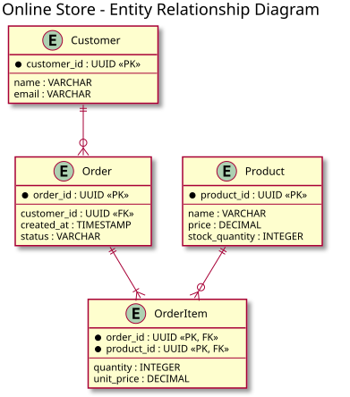

# オンラインストア設計資料

## 概要

本資料は、オンラインストアの設計を3種類のUML図で説明するものです。

- **クラス図**: アプリケーション内の主要なオブジェクトと、その関係を示します。
- **ER図**: データベースに保存するエンティティ、属性、キー、および関連を示します。
- **シーケンス図**: 顧客が注文を送信してから、注文が保存されるまでの処理順序を示します。

図はそれぞれ異なる視点を持つため、クラス図で業務モデルを確認し、ER図で永続化モデルを確認したうえで、シーケンス図で注文処理の動きを確認します。

## 1. クラス図

### クラス図の説明

クラス図は、オンラインストアで扱う主要なオブジェクトと責務を表します。

- **Customer** は顧客を表し、顧客ID、氏名、メールアドレスを保持します。
- **Product** は商品を表し、価格と在庫数を保持します。
- **Order** は注文を表し、作成日時、注文状態、注文合計の計算処理を持ちます。
- **OrderItem** は注文内の商品明細を表し、数量、注文時単価、小計の計算処理を持ちます。
- **OrderStatus** は注文状態を表す列挙型で、`Pending`、`Paid`、`Shipped`、`Cancelled` を定義します。

顧客は複数の注文を作成でき、1つの注文は1件以上の注文商品明細を含みます。各注文商品明細は、1つの商品を参照します。注文状態は `Order.status` 属性で管理されます。

## 2. ER図

### ER図の説明

ER図は、クラス図のモデルをリレーショナルデータベースの構造に対応付けたものです。

- **Customer** テーブルは `customer_id` を主キーとし、`email` は一意キーです。
- **Product** テーブルは商品情報と在庫数を保持します。
- **Order** テーブルは `customer_id` を外部キーとして顧客と関連付けます。
- **OrderItem** テーブルは `order_id` と `product_id` の複合主キーを持ち、注文と商品を関連付けます。
- 注文商品明細には、注文時点の価格を `unit_price` として保存します。商品の現在価格が変更されても、過去の注文金額を再現できます。

顧客と注文、注文と注文商品明細、商品と注文商品明細の関係をデータベース上で表現することで、注文履歴と在庫対象商品を追跡できます。

## 3. 注文処理のシーケンス図

### シーケンス図の説明

シーケンス図は、顧客が注文を送信したときの処理を時系列で示します。

1. 顧客が **Storefront** に注文を送信します。
2. **Storefront** が **Order Service** の `placeOrder(items)` を呼び出します。
3. **Order Service** が **Inventory** に商品の在庫確認と引当を依頼します。
4. 在庫がある場合、引当を確定した後、**Order Database** に注文を保存します。
5. データベースから注文IDを受け取り、Storefrontを通じて顧客に注文確認を表示します。
6. 商品が不足している場合は注文を保存せず、利用できない商品があることを顧客に通知します。

この処理では、在庫引当が成功した場合だけ注文を保存するため、在庫不足の注文が確定することを防ぎます。

## 図の対応関係

3つの図は、同じオンラインストアを次のように異なる粒度で表しています。

| 図           | 主な対象                       | 確認できる内容                                     |
| ------------ | ------------------------------ | -------------------------------------------------- |
| クラス図     | アプリケーションのオブジェクト | クラスの属性、操作、オブジェクト間の関係           |
| ER図         | データベースのエンティティ     | テーブル、主キー、外部キー、カーディナリティ       |
| シーケンス図 | 注文処理の実行時動作           | 登場人物、サービス間の呼び出し、成功・失敗時の分岐 |
